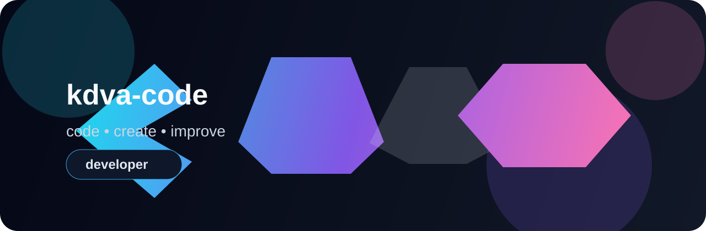
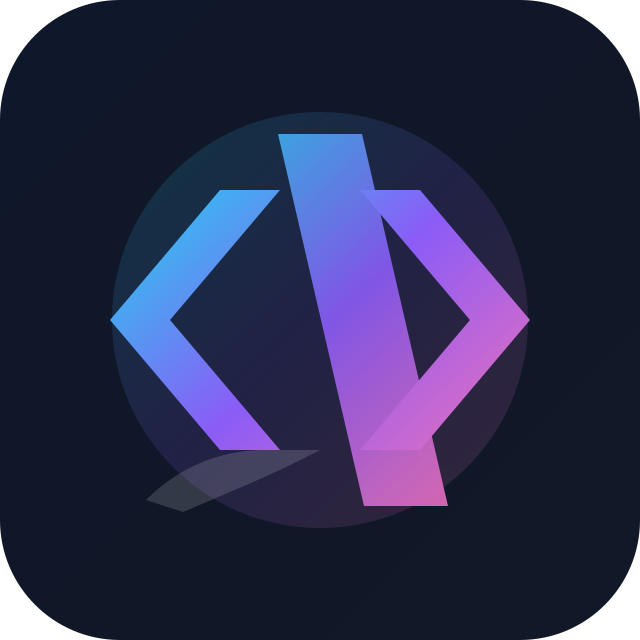
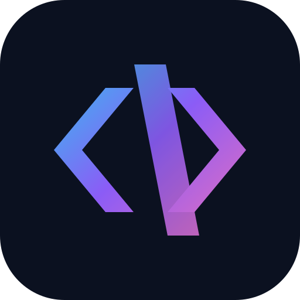

# kdva-code

  

  

  
  
  

Hi, I'm **kdva-code**. I enjoy writing code, building useful products, and learning along the way. This profile is where I share my work and experiments in web development, software engineering, and automation.

## About me

- I build web and mobile applications.
- I work on backend services and API architecture.
- I care about thoughtful UI/UX and a smooth user experience.
- I value clean, reliable, and maintainable code.
- I'm always exploring new tools and technologies.

## Technologies

  
  
  
  
  
  
  
  
  

## What I like to build

- Small and medium-sized web applications
- APIs and backend services
- Reusable UI components and interactive interfaces
- Polished, optimized, production-ready software

## GitHub stats

  

> “Good code is not just code that works—it is code that is clear, easy to extend, and maintain.”

  

